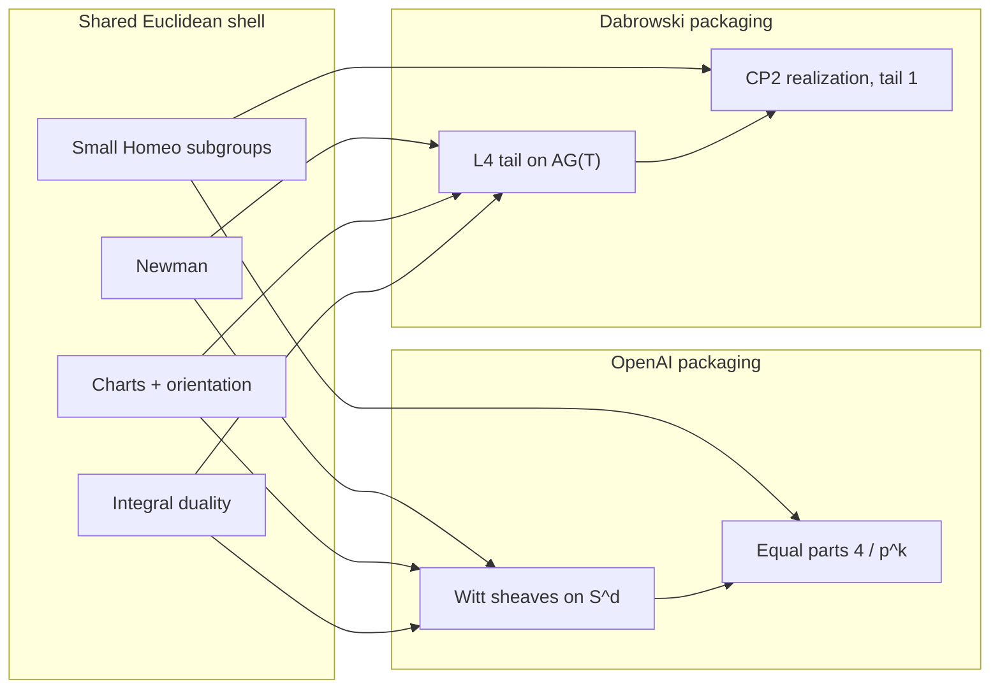

# Dabrowski vs OpenAI: same obstruction class, different packaging

Both preprints claim the Hilbert–Smith conjecture in every finite dimension by excluding faithful continuous \(\mathbb{Z}_p\)-actions on topological manifolds. Neither uses Yang’s orbit-dimension raising, and neither is Pardon’s 3-manifold mapping-class argument. They sit in the same **family**: integrality versus \(p\)-divisibility of a signature / Witt invariant manufactured from a Euclidean chart and a small open subgroup of \(\mathrm{Homeo}\).

OpenAI audit: [`docs/Hilbert_Smith_Audit.pdf`](../../docs/Hilbert_Smith_Audit.pdf) (this repo, 2026-09-23 preprint).  
Dabrowski audit: this directory.

---

## One-line mechanisms

| | OpenAI (2026-09-23) | Dabrowski (2026-10-08) |
|--|---------------------|------------------------|
| Invariant | Sheaf Witt group \(E_d(S^d)\) of continuous polyhedral forms | Ultimate quadratic \(L_4\) of an asymptotic category \(A_G(T)\) |
| Integrality | Fixed denominator lattice \(L_d^{-1}\mathbb{Z}\,\overline{u}_d\), \(L_d=2^{e_d}\) | Ordinary integer signatures; tail in \(\mathbb{Z}^{\mathbb{N}}/\mathbb{Z}^{(\mathbb{N})}\) |
| \(p\)-input | \(p^k\) equal character pieces summing to \(4\overline{u}_d\) | Permutation form \(\tau=\mathbb{Q}[G_i/P_i]\) locally \(p\) copies of \(\mathrm{id}\); \(\nu^s=0\) |
| Contradiction | \(4/p^k\notin L_d^{-1}\mathbb{Z}\) for \(p^k>4L_d\) | \(1\in p\mathbb{Z}\) |
| Test space | Odd-dimensional sphere \(S^d\) after stabilizing \(O\subset\mathbb{R}^n\) | \(S^n\times\mathbb{CP}^2\); iterated boundaries recover \(\mathbb{CP}^2\) |
| Averaging | Haar-average a degree-one pinch through \(Y=W^+/H\) | Haar-average **coordinates** in a chart; pinch \(f\) on the compactified \(S^n\) |
| Formalization | None found in the OpenAI dump | Claimed Lean 4 certificate (`HSFormal/`, 238 modules) — not rerun here |

---

## Shared Euclidean ingredients

These four properties are what sponges lack and what both proofs spend their geometric budget on:

1. **Newman rigidity.** Small compact Lie actions that barely move a chart ball are trivial. Used by OpenAI in chart reduction; by Dabrowski in Corollary 1.2 (after p-adic exclusion) via [Pa19].
2. **Local Euclidean charts + orientation.** OpenAI: invariant \(O\subset\mathbb{R}^n\), stabilize into \(S^d\). Dabrowski: free point, chart containing \(B(0,4)\), compactify to \(S^n\), product with \(\mathbb{CP}^2\).
3. **Local duality / integral signature.** OpenAI: Verdier duality + Balmer triangular Witt + semialgebraic comparison. Dabrowski: controlled Poincaré–Lefschetz dual cells + Ranicki Poincaré pairs + Karoubi localization.
4. **Arbitrarily small open subgroups of \(\mathrm{Homeo}\).** Both need a tail of \(\mathbb{Z}_p\) small enough that Haar averaging preserves degree one (OpenAI) or produces a signature-one \(\mathbb{CP}^2\) germ (Dabrowski), and fine enough that finite quotients are unbounded \(p\)-powers.

On Menger / solenoid / Raymond–Williams spaces, **(1)–(2) fail first** for both arguments. That is why neither “proves too much.”

---

## Where they diverge

| Topic | OpenAI | Dabrowski |
|-------|--------|-----------|
| Dimension shift | Odd stabilize \(d>n\) so \(\pi_*(S^d)\) is Serre-rationally concentrated | Keep dimension \(n\); add \(\mathbb{CP}^2\) to land in \(L_4\) after \(n\) boundaries |
| Character theory | Finite partitions of \(p\)-power roots of unity on the punctured target | Equivariant signature characters of \(\mathbb{Q}[G_i]\); cyclotomic Lemma 3.1 |
| Lattice | Uniform 2-power denominator from \(\mathcal{P}\to\mathcal{T}\) comparison | No denominator bookkeeping; integers from rational Witt / \(L_4\) |
| Orbit space | Explicit test \(S^d\to Y\to S^d\) | Invariant pinch on \(S^n\); orbit space of \(T\) is a covering, not the manifold quotient |
| Cited black boxes | Balmer–Walter 2002; Woolf; Hardt | Carlsson–Pedersen 1995; Ranicki 1980/89/92/99; Balmer–Schlichting 2001; Weibel negative \(K\) |
| Weak spots (this repo’s grades) | Dense doubling; BW localization; character coproducts; equal-parts isometry | Tail extraction / NegK; MV nilpotence; graph corner; \(\mathbb{CP}^2\) evaluation; Lean axiom print |
| Boundary | Statement is without boundary | Paper allows boundary; Lean has both forms |

---

## What a common research question looks like

If both arguments are pointing at the same rigidity of Euclidean space, the mathematical question is **not** “which PDF is correct?” but:

Which of (1)–(4) is the essential obstruction to continuous \(\mathbb{Z}_p\)-actions, and which can fail independently?

That is the MathOverflow rewrite in [`docs/POST_DRAFTS.md`](../../docs/POST_DRAFTS.md): a question about Euclidean structure, with both preprints as motivation.

---

## Audit status comparison (targeted, 2026-10-08)

| | OpenAI | Dabrowski |
|--|--------|-----------|
| FAIL | 0 | 0 |
| Headline WEAK | 4 lemmas | 5 clusters (NegK/tail, MV nilpotence, graph corner, \(\mathbb{CP}^2\) signs, Lean axioms) |
| Sponge overclaim | No | No |
| Finite \(\mathbb{Z}/p\) sanity | Breaks at averaged-test | Breaks at unbounded tail / deg-1 Haar |
| Lean | None | Claimed; not independently printed here |
