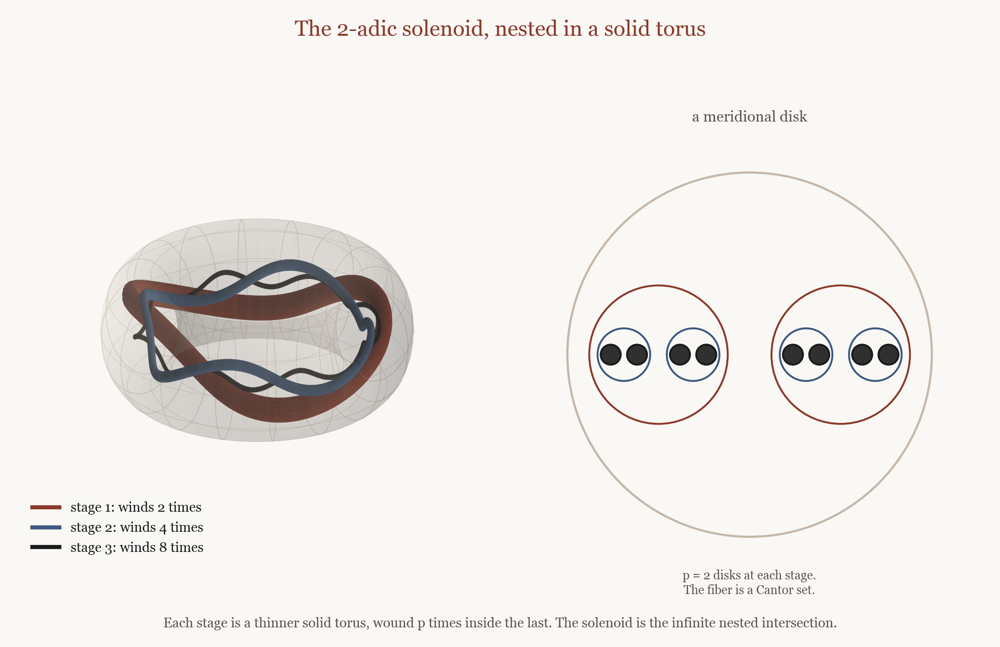
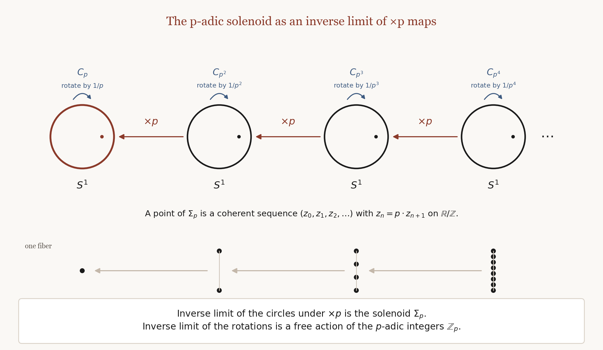

# Hilbert's 5th and the Hilbert–Smith Conjecture: Solved?

Date: 22 October 2026  
Authors:

    Alan J. Coppola
    
    Ajjax - Joint author and AI assistant (using Cursor with Grok, Anthropic, Google and OpenAI tools)

A development story: learning, verification, and questions. Not a proof.

---

Hilbert’s fifth problem asked whether a continuous group of transformations must be a Lie group, even if one does not assume differentiability. For the group itself the answer is yes: a locally Euclidean locally compact group is a Lie group. What remains is a question about *actions*. That leftover is the Hilbert–Smith conjecture: a locally compact group that moves a connected manifold continuously and faithfully should still be a Lie group.

The hard case is one compact group. The *p*-adic integers are a Cantor set, built as an inverse limit of finite cyclic groups. Finite cyclic groups of prime-power order already act on manifolds. Hilbert–Smith says the infinite chain cannot.

The same inverse-limit idea, run on circles instead of finite groups, is the *p*-adic solenoid.

*p = 2 in the picture; a general prime winds p times. The solenoid is the infinite nested intersection. A meridional slice meets each stage in p disks, and the fiber is a Cantor set.*

*Each bonding map is multiplication by p on the circle. Compatible rotations assemble to a free action of the p-adic integers. The orbit space is a circle. The solenoid is compact and connected. It is not a manifold.*

If a *p*-adic action on a Euclidean manifold existed, Newman’s theorem would cut it down to a small open subgroup that still moves some Euclidean ball. The rest of the subject is a search for a contradiction in motion that can be made arbitrarily small.

This October, OpenAI included a Hilbert–Smith claim in a public dump of manuscripts. A few days later A. Dabrowski posted another argument, with a claimed Lean certificate. I put my reading of those writeups, and some work off Euclidean manifolds, in one GitHub repository. I directed the reading in Cursor, with Ajjax, using Grok, Anthropic, and OpenAI models. I am trying to understand the arguments, and to help check them. I am also looking at whether they extend to cohomology manifolds. I am not announcing that Hilbert–Smith is proved.

Both 2026 arguments start from a Euclidean chart. They manufacture a unit — a degree-one map, or a signature-one class — then split it by covering degree until the arithmetic will not hold. On spaces that already carry a faithful *p*-adic action (a Menger compactum, the circle solenoid in the pictures, a Raymond–Williams example), the break looks to me like the missing chart, not the arithmetic. If you leave the Euclidean neighborhood, you have not been given a license to build an action.

The remaining open example, as far as I have been able to construct one, is an effective *p*-adic action on a compact integer-cohomology manifold of finite cohomological dimension and infinite covering dimension. Local duality can still look *n*-dimensional over the integers, while covering dimension is infinite in every neighborhood. The papers in that arena are in the repository.

The repo also has tutorial slides that try to make the algebra geometric. Comments of any kind are welcome.

Repository: https://github.com/ajjcoppola/hilberts-5th-oai

Draft paper: https://github.com/ajjcoppola/hilberts-5th-oai/blob/main/papers/padic-homology-manifolds/main.pdf  
Invariants slides: https://github.com/ajjcoppola/hilberts-5th-oai/blob/main/presentations/invariants-quinn-witt-dabrowski/invariants-quinn-witt-dabrowski.pdf  
Homology-manifold slides: https://github.com/ajjcoppola/hilberts-5th-oai/blob/main/presentations/padic-homology-2026/padic-homology-2026.pdf

This essay, and the notes it points to, are joint work with my AI assistant Ajjax, using Cursor, with Grok, Anthropic, and OpenAI models, under my direction. Errors remain mine.
